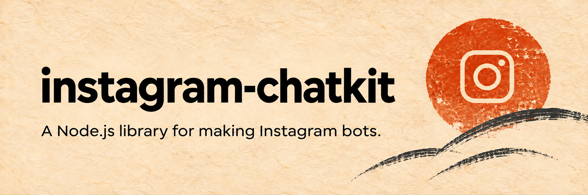
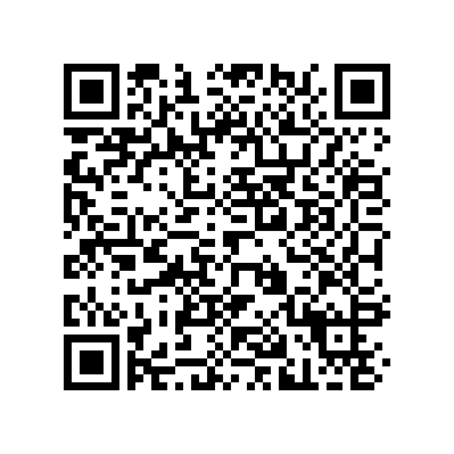

<div align="center">
  
  <h1>instagram-chatkit</h1>
  <p><a href="https://github.com/ttkienn/instagram-chatkit#readme">English</a> · <strong>Tiếng Việt</strong></p>
  <p>Gửi và nhận tin nhắn Instagram trên Node.js, đăng nhập bằng cookie trình duyệt.</p>
  <p>
    <a href="https://www.npmjs.com/package/instagram-chatkit"></a>
    
    <a href="https://github.com/ttkienn/instagram-chatkit/blob/main/LICENSE"></a>
  </p>
  <p>
    <a href="https://github.com/ttkienn/instagram-chatkit/blob/main/docs/DOCS.md">Các hàm</a> ·
    <a href="https://github.com/ttkienn/instagram-chatkit/blob/main/examples/receive-message.js">Ví dụ</a> ·
    <a href="https://github.com/ttkienn/instagram-chatkit">GitHub</a> ·
    <a href="https://github.com/ttkienn/instagram-chatkit/issues">Báo lỗi</a>
  </p>
</div>

---

## Cài đặt

Cần Node.js 24 trở lên.

```bash
npm install instagram-chatkit
```

## Lấy cookie

Trên Chrome hoặc Edge, đăng nhập [Instagram](https://www.instagram.com), nhấn F12 → **Network** rồi tải lại trang. Chọn request tới `www.instagram.com` → **Headers → Request Headers → cookie**, nhấp phải dòng đó → **Copy value**. Dán nguyên chuỗi vừa chép vào `IGCHAT_COOKIES` trong `.env`:

```dotenv
IGCHAT_COOKIES="sessionid=...; csrftoken=...; ds_user_id=..."
```

## Ví dụ

Lưu code sau thành `bot.mjs`:

```js
import { InstagramClient } from 'instagram-chatkit';

const client = new InstagramClient({
  cookies: process.env.IGCHAT_COOKIES,
  receiving: { receiveOwnMessages: false },
});

client.onMessage(async function (message) {
  if (message.text === '/ping') {
    await message.replyText('pong');
  }
});

client.onHandlerError(function (error) {
  console.error(error.code);
});

async function main() {
  await client.login();
  await client.connectRealtime();
}

main().catch(async function (error) {
  console.error(error.code);
  await client.close();
  process.exitCode = 1;
});
```

Chạy và gửi `/ping` từ tài khoản khác:

```bash
node --env-file=.env bot.mjs
```

Khi dừng ứng dụng, gọi `await client.close()`. [Ví dụ đầy đủ](https://github.com/ttkienn/instagram-chatkit/blob/main/examples/receive-message.js) đã có xử lý Ctrl+C.

## Tài liệu

| Bạn cần | Xem tại |
| --- | --- |
| Tra hàm gửi, nhận tin, media và bộ lọc | [Các hàm và cách dùng (tiếng Anh)](https://github.com/ttkienn/instagram-chatkit/blob/main/docs/DOCS.md) |
| Chạy thử gửi hoặc nhận tin | [Gửi tin](https://github.com/ttkienn/instagram-chatkit/blob/main/examples/send-message.js) · [Nhận tin](https://github.com/ttkienn/instagram-chatkit/blob/main/examples/receive-message.js) |
| Chạy bot có sẵn | [Ví dụ bot](https://github.com/ttkienn/instagram-chatkit/blob/main/examples/optional/bot.js) |
| Sửa code thư viện | [Cấu trúc code (tiếng Anh)](https://github.com/ttkienn/instagram-chatkit/blob/main/docs/ARCHITECTURE.md) |

## Lưu ý

- Không đưa cookie, `.env` hoặc file lưu đăng nhập lên Git.
- Đăng bài, Stories, Highlights, Live và caption chung trong tin ảnh chưa được hỗ trợ.
- Gặp `DELIVERY_UNKNOWN` thì kiểm tra chat trước khi gửi lại, tránh trùng tin.

## Tác giả

<table>
  <tr>
    <td align="center" width="100">
      <a href="https://github.com/ttkienn">
        
      </a>
    </td>
    <td>
      <strong>Thiệu Trung Kiên</strong><br>
      <a href="https://www.facebook.com/ttkiennn">Facebook</a> ·
      <a href="https://github.com/ttkienn">GitHub</a> ·
      <a href="https://www.npmjs.com/~thieutrungkien2">npm</a>
    </td>
  </tr>
</table>

## Ủng hộ

<p align="center">
  <br>
  <strong>MB Bank · 543888999</strong>
</p>

Quét QR bằng ứng dụng ngân hàng và nhập số tiền bạn muốn gửi.

## Giấy phép

[MIT](https://github.com/ttkienn/instagram-chatkit/blob/main/LICENSE). Các phần từ dự án khác giữ giấy phép gốc; xem [thông tin bản quyền](https://github.com/ttkienn/instagram-chatkit/blob/main/licenses/THIRD_PARTY_NOTICES.txt).
